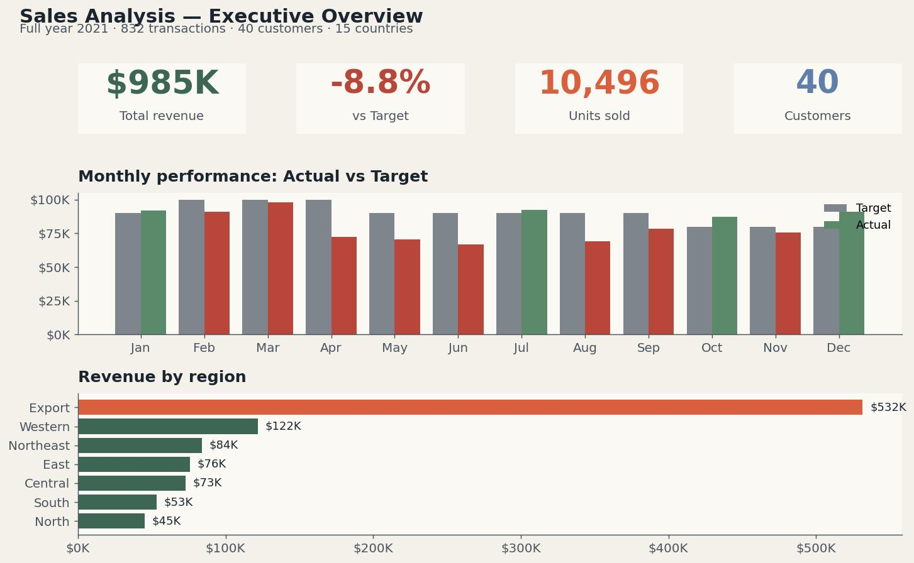
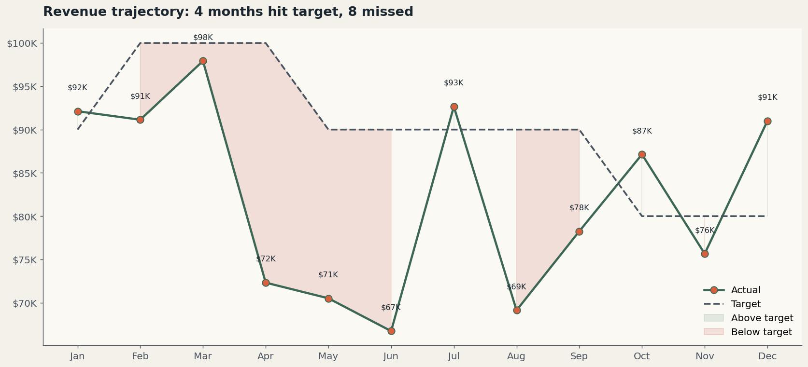
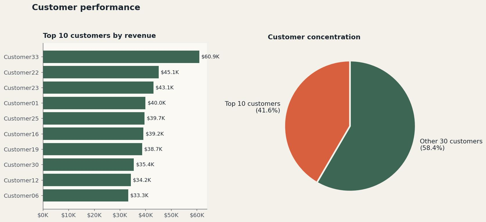
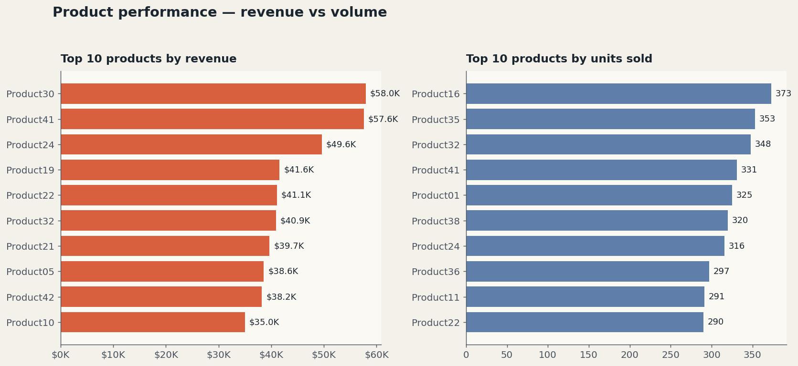
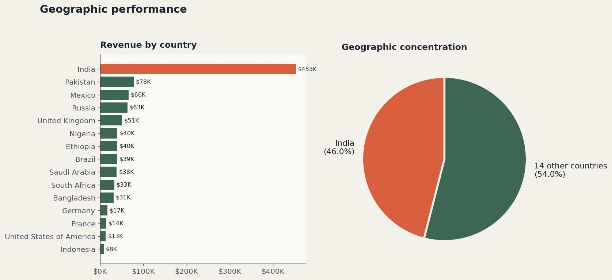
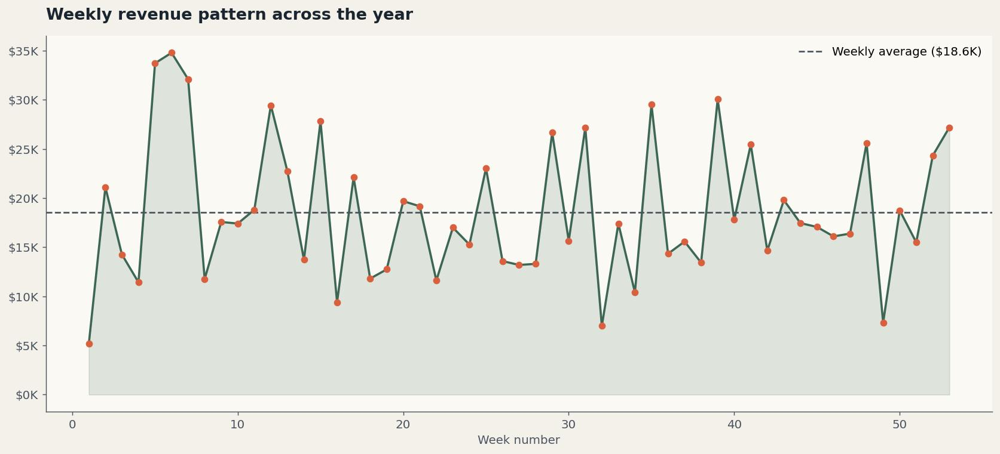

# Sales Analysis

**Sales data, turned into decisions.**

A full year of 2021 sales transactions, cleaned and shaped into an Excel dashboard that surfaces where revenue came from and where it fell short.



## Quick links

- 🌐 [Open the live workbook on OneDrive](https://1drv.ms/x/c/5c96de2b5cf375c8/IQBf8R42OebgSb2fUt9Q7SRJAdcinKj4oXlFcO8hkwxdgyE?e=rtabHb)
- 📄 [Read the documentation (PDF)](docs/Sales-Analysis-Documentation.pdf)
- 📊 [Download the Excel workbook](workbook/Sales_Analysis.xlsx)
- 🎞️ [Editable PowerPoint deck](docs/Sales-Analysis-Documentation.pptx)

---

> **A note on GitHub previews.** GitHub renders Markdown, PDFs, and images inline. It does not preview Excel workbooks or PowerPoint files in the browser. For those, GitHub shows a file page with a **Download** button on the top right. This is normal.

---

## Table of Contents

- [About the project](#about-the-project)
- [Headline findings](#headline-findings)
- [Dashboards](#dashboards)
- [Repository structure](#repository-structure)
- [Data dictionary](#data-dictionary)
- [How the workbook is organized](#how-the-workbook-is-organized)
- [Run it locally](#run-it-locally)
- [Key insights](#key-insights)
- [Recommendations](#recommendations)
- [Tech stack](#tech-stack)
- [Limitations](#limitations)
- [License](#license)

---

## About the project

Sales Analysis takes 832 transactions from full year 2021 and turns them into an answer to one question. *Where did the year hit, and where did it miss?*

The work covers the full BI cycle inside a single Excel workbook:

1. **Joining** transaction data with the target table and the customer reference table
2. **Modeling** the data with derived fields like Month and Week
3. **Aggregating** through pivot tables across customer, product, region, country and time
4. **Visualizing** results in an interactive dashboard with slicers and target benchmarks

The dataset covers 832 transactions across 40 customers, 44 products, 15 countries and 7 regions, with monthly revenue targets to benchmark against.

---

## Headline findings

| Metric | Value | Note |
|---|---|---|
| Total revenue earned | **$985K** | Across 832 transactions |
| Target variance | **-8.8%** | Missed the $1.08M annual target by $95K |
| Months that hit target | **4 of 12** | January, July, October, December |
| Export region revenue | **$532K** | 54% of total revenue |
| India country share | **46%** | $453K of total revenue |
| Top 10 customer share | **53%** | Significant concentration risk |

---

## Dashboards

Click any image to view full size.

### 1. Executive overview

*The year in one view: revenue, target gap, and regional split.*


### 2. Monthly trend

*Actual vs target across all 12 months.*



### 3. Customer performance

*Top 10 customers and the concentration of the book.*



### 4. Product performance

*Top 10 products by revenue and volume.*



### 5. Geographic performance

*Revenue by country and the India dependency.*



### 6. Weekly pattern

*Revenue swings across all 52 weeks of the year.*



For the full narrative behind each view, see [the documentation PDF](docs/Sales-Analysis-Documentation.pdf).

---

## Repository structure

```
sales-analysis/
│
├── README.md                               This file
├── LICENSE                                 MIT
├── CONTRIBUTING.md                         Contribution guidelines
├── .gitignore
│
├── docs/
│   ├── Sales-Analysis-Documentation.pdf    Renders inline on GitHub
│   ├── Sales-Analysis-Documentation.pptx   Editable PowerPoint
│   └── screenshots/                        Dashboard JPGs and hero image
│
└── workbook/
    └── Sales_Analysis.xlsx                 The interactive Excel workbook
```

---

## Data dictionary

The transaction log lives in the **Input Data** sheet of the workbook.

| Column | Type | Description |
|---|---|---|
| `DATE` | Date | Transaction date |
| `CUSTOMER NAME` | Text | Customer identifier (Customer01 to Customer40) |
| `PRODUCT` | Text | Product identifier (Product01 to Product44) |
| `UNIT PRICE ($)` | Decimal | Price per unit in USD |
| `QUANTITY` | Integer | Units sold in the transaction |
| `Actual` | Decimal | Total transaction value (Unit Price × Quantity) |
| `Country` | Categorical | One of 15 countries |
| `Region` | Categorical | One of 7 regions including Export |
| `Month` | Derived | Month name from DATE |
| `Week` | Derived | ISO week number from DATE |

---

## How the workbook is organized

The workbook has six sheets. Each one does one thing.

| Sheet | Purpose |
|---|---|
| `Input Data` | 832 row transaction log. The single source of truth for everything downstream. |
| `Target` | Monthly revenue targets with above/below variance calculations |
| `Customer` | 40 customer to country to region mapping for joins and lookups |
| `Detail1` | Pivot drill-down view of transactions for ad-hoc inspection |
| `Analysis` | Aggregated views by month, week, customer, product, country, region |
| `Dashboard` | The interactive dashboard with slicers, KPI cards and charts |

---

## Run it locally

### Option 1: Open the live workbook on OneDrive

[Click here to open the workbook in Excel for the web](https://1drv.ms/x/c/5c96de2b5cf375c8/IQBf8R42OebgSb2fUt9Q7SRJAdcinKj4oXlFcO8hkwxdgyE?e=rtabHb). No download, no install. The dashboard, slicers and pivot tables work directly in the browser.

### Option 2: Download and open in Excel Desktop

1. Clone or download this repository
2. Open `workbook/Sales_Analysis.xlsx` in Microsoft Excel 2016 or later
3. Enable editing if prompted
4. Open the `Dashboard` sheet
5. Use the slicers to filter by Region, Country, or Month

The workbook is self-contained. No external connections, no Power Query refresh required.

---

## Key insights

1. **The year missed target by 8.8%.** Total revenue of $985K against a $1.08M target. Only 4 of 12 months hit their monthly number.

2. **Export is the business, not a side bet.** Export region alone delivered $532K, 54% of total revenue. Removing Export would gut the year.

3. **India is the single biggest country exposure.** India contributed $453K, 46% of revenue. The remaining 14 countries split the other 54%.

4. **Customer concentration is high.** The top 10 customers carry 53% of revenue. Losing any one of them moves the needle.

5. **Midyear performance collapsed.** April through September averaged $75K monthly against a $93K target. Something specific happened in Q2 and Q3.

---

## Recommendations

| Priority | Action | Expected impact |
|---|---|---|
| High | Diagnose the Q2-Q3 revenue drop | Find the cause behind six straight months under target |
| High | Build a top-10-customer retention plan | Protect 53% of revenue with active account management |
| Medium | Diversify beyond India | Reduce 46% country concentration over 3 years |
| Medium | Recalibrate monthly targets | Fix Q4 targets that were 11% lower than Q1 with no documented reason |
| Low | Add customer profitability tracking | Pair revenue with margin per customer to find truly profitable accounts |

Full discussion in [the documentation PDF](docs/Sales-Analysis-Documentation.pdf).

---

## Tech stack

| Layer | Tool |
|---|---|
| Data cleaning | Excel formulas, Power Query |
| Modeling | Pivot tables, derived columns, slicers |
| Visualization | Excel pivot charts, conditional formatting for target tracking |
| Documentation | PowerPoint (editorial deck), PDF export for inline GitHub preview |

---

## Limitations

- **Source dataset is synthetic.** Customer and product names follow generic patterns (Customer01, Product01). Treat the insights as a demonstration of the analytical approach.
- **No margin data.** Revenue is tracked, but cost of goods is not in the dataset. Profitability analysis would require additional inputs.
- **Single year only.** 2021 data alone makes seasonality and year-over-year analysis impossible.

---

## License

Released under the MIT License. See [LICENSE](LICENSE) for details.

---

**Built by Bih Brandy** · Business Intelligence Analyst · Microsoft Fabric and Power BI Specialist

- 🌐 [Live workbook on OneDrive](https://1drv.ms/x/c/5c96de2b5cf375c8/IQBf8R42OebgSb2fUt9Q7SRJAdcinKj4oXlFcO8hkwxdgyE?e=rtabHb)
- 📄 [Documentation PDF](docs/Sales-Analysis-Documentation.pdf)
- 📊 [Excel workbook](workbook/Sales_Analysis.xlsx)
- 🎞️ [PowerPoint deck](docs/Sales-Analysis-Documentation.pptx)
